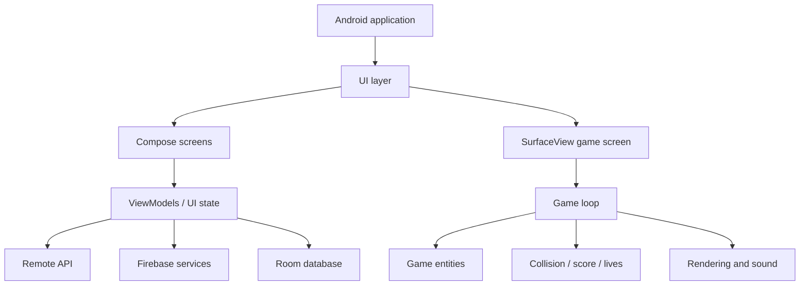

# Mobile Platforms — Android Development Coursework

A collection of Android applications developed with **Kotlin** as part of the Game Development for Mobile Platforms course at IPCA. The repository documents a progression through native Android UI development, API consumption, real-time game loops, Firebase integration and local persistence.

**Course:** Game Development for Mobile Platforms  
**Academic year:** 2025/2026  
**Primary language:** Kotlin  
**IDE:** Android Studio

## Projects

| Project | Description | Main concepts |
|---|---|---|
| `Calculator/` | A calculator application with a separate calculation engine and UI components | State, operations, UI composition |
| `API/` | Dog breed browser using the Dog CEO API | HTTP requests, JSON parsing, loading/error states, navigation |
| `FruitCatcher/` | Touch-controlled fruit-catching game | Custom game loop, rendering, collision detection, score and lives |
| `FruitCatcher++/` | Extended Fruit Catcher project | Firebase authentication and score-related features, sound and game UI |
| `PawPedia/` | Dog breed application with favourites | API data, local persistence with Room, navigation and UI state |

## Technology stack

- **Kotlin** — application and game logic.
- **Android SDK** — native Android platform.
- **Jetpack Compose** — used by the API and PawPedia applications for declarative UI.
- **Android Views / SurfaceView / Canvas** — used by the Fruit Catcher game loop.
- **OkHttp and JSON** — HTTP requests and response parsing in the API project.
- **Firebase** — authentication and score-related functionality in FruitCatcher++.
- **Room** — local database for saved dog/favourite data in PawPedia.
- **Gradle Kotlin DSL** — Android project configuration.

## Architecture and implementation highlights

### Calculator

The calculator separates the calculation logic from the UI:

- `CalculatorBrain.kt` defines supported operations and maintains calculation state.
- `CalculatorButton.kt` provides the calculator button component.
- `CalculatorView.kt` builds the calculator interface.
- `MainActivity.kt` is the Android entry point.

The calculation engine supports addition, subtraction, multiplication, division, percentage, square root, clear and all-clear operations.

### API — Dog breed browser

The API application consumes the public Dog CEO endpoint:

```text
https://dog.ceo/api/breeds/list/all
```

`MainActivity` configures Compose Navigation with a dog-list route and a breed-detail route. `DogListViewModel` performs the asynchronous HTTP request using OkHttp, parses the JSON response and exposes loading, error and result state to the UI.

Main components:

- `DogListView` — displays the available breeds.
- `DogListViewModel` — requests and parses the breed list.
- `DogDetailView` — displays the selected breed.
- `DogDetailViewModel` — manages detail-screen data.
- `Dog` — model representing breed information.

### FruitCatcher

FruitCatcher uses a custom game loop rather than a game engine. `GameView` extends Android's `SurfaceView` and implements `Runnable`.

The loop repeatedly:
1. Updates the catcher and fruit positions.
2. Checks whether fruit has left the screen.
3. Checks collisions between fruit and the catcher.
4. Updates score and lives.
5. Draws the background, catcher, fruit and HUD to the surface.
6. Sleeps briefly to regulate the loop.

Touch input updates the horizontal target position of the catcher. The game uses separate `Catcher`, `Fruit` and `SoundManager` classes.

### FruitCatcher++

This is the extended FruitCatcher project. It retains the custom `SurfaceView` game loop and adds account/score-related application functionality. The source includes repositories for authentication and scores, a player-score model, view models and separate home, game and game-over views.

### PawPedia

PawPedia extends the dog-breed API application with local data storage. Its source includes:

- A `Dog` entity and `AppDatabase` built with Room.
- A `FavoritesViewModel` for favourite management.
- A sealed `Screen` model for home and favourites navigation.
- A `SoundManager` for audio feedback.

## Architecture overview



The diagram represents the different approaches used across the coursework projects; not every application uses every component.

## Running the applications

Each folder is an independent Android Studio / Gradle project. Open the relevant project directory in Android Studio rather than treating the repository root as a single Android application.

Typical workflow:

1. Install Android Studio and a compatible Android SDK.
2. Open one of the project folders (`Calculator`, `API/TrabalhoAPI`, `FruitCatcher`, `FruitCatcher++` or `PawPedia`).
3. Allow Gradle to sync.
4. Configure any required Firebase project settings for `FruitCatcher++`.
5. Run the `app` configuration on an emulator or Android device.

The exact SDK and dependency versions are defined in each project's Gradle files.

## Repository structure

```text
Mobile-Platforms/
├── Calculator/       # Calculator application
├── API/              # Dog CEO API application
├── FruitCatcher/     # Custom SurfaceView game
├── FruitCatcher++/   # Extended game with account/score features
└── PawPedia/         # Dog API application with Room favourites
```

## Notes for contributors and reviewers

- The folders are separate coursework projects, not modules of one shared app.
- The repository archive supplied for documentation review contains generated Android build output and IDE metadata in addition to source files. These generated files should generally be excluded from version control using appropriate `.gitignore` rules.
- Some folders contain nested or duplicated project copies. Before reorganising the repository, compare the copies and confirm which version is the intended canonical project.
- Firebase configuration and provider setup are required for Firebase-backed features; do not publish private service-account credentials.

---

*Academic coursework developed at IPCA.*
